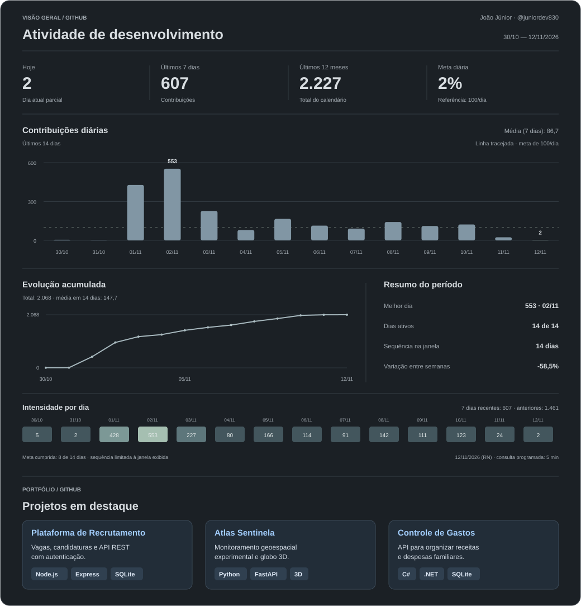

  

 

  <strong>João Júnior</strong> · Engenharia de Software em formação

  
Desenvolvendo soluções modernas com foco em aplicações web, APIs, automação e arquitetura de software.

<h3 align="center">Principais Tecnologias</h3>

<table align="center">
  <tr>
    <th align="center" width="35%">Front-end</th>
    <th align="center" width="38%">Back-end &amp; APIs</th>
    <th align="center" width="27%">Cloud &amp; DevOps</th>
  </tr>
  <tr>
    <td align="center">
      
    </td>
    <td align="center">
      
    </td>
    <td align="center">
      
    </td>
  </tr>
</table>

<h3 align="center">Projetos em Destaque</h3>

<table>
  <tr>
    <td width="33%" valign="top">
      <a href="https://github.com/juniordev830/plataforma-de-recrutamento"><strong>Plataforma de Recrutamento</strong></a>
      
Vagas, candidaturas e API REST com autenticação.

      
<code>Node.js</code> <code>Express</code> <code>SQLite</code>

      <a href="https://github.com/juniordev830/plataforma-de-recrutamento">Ver projeto</a>
    </td>
    <td width="33%" valign="top">
      <a href="https://github.com/juniordev830/sentinel-atlas"><strong>Sentinel Atlas</strong></a>
      
Monitoramento geoespacial experimental e globo 3D.

      
<code>Python</code> <code>FastAPI</code> <code>3D</code>

      <a href="https://github.com/juniordev830/sentinel-atlas">Ver projeto</a>
    </td>
    <td width="33%" valign="top">
      <a href="https://github.com/juniordev830/controle-gastos-residenciais"><strong>Controle de Gastos</strong></a>
      
API para organizar receitas e despesas familiares.

      
<code>C#</code> <code>.NET</code> <code>SQLite</code>

      <a href="https://github.com/juniordev830/controle-gastos-residenciais">Ver projeto</a>
    </td>
  </tr>
</table>

<h3 align="center">Contribuições Diárias</h3>

<!-- CONTRIBUTIONS:START -->

<table align="center">
<thead><tr><th>Hoje</th><th>Ontem</th><th>Últimos 7 dias</th><th>Últimos 12 meses</th></tr></thead>
<tbody><tr><td align="center"><strong>112</strong></td><td align="center"><strong>111</strong></td><td align="center"><strong>816</strong></td><td align="center"><strong>2.190</strong></td></tr></tbody>
</table>

Média dos últimos 7 dias: <strong>116,6</strong> contribuições por dia.

Ver contribuições por dia — últimos 14 dias

| Data (RN) | Contribuições |
| :--- | ---: |
| 10/11/2026 | 112 |
| 09/11/2026 | 111 |
| 08/11/2026 | 142 |
| 07/11/2026 | 91 |
| 06/11/2026 | 114 |
| 05/11/2026 | 166 |
| 04/11/2026 | 80 |
| 03/11/2026 | 227 |
| 02/11/2026 | 553 |
| 01/11/2026 | 428 |
| 31/10/2026 | 2 |
| 30/10/2026 | 5 |
| 29/10/2026 | 1 |
| 28/10/2026 | 3 |

Dados de 10/11/2026. Consulta programada a cada 5 minutos, sujeita a atrasos do GitHub. As novas contagens aparecem ao recarregar o perfil. <a href="https://github.com/juniordev830/juniordev830/actions/workflows/contribuicoes-diarias.yml">Ver última execução</a>.

<!-- CONTRIBUTIONS:END -->

  <a href="https://joao-github-dashboard.joaosilva42333.chatgpt.site"><strong>📊 Abrir painel interativo completo ↗</strong></a> 
  Gráficos, filtros e exportação CSV · acesso pessoal com a conta ChatGPT do proprietário.

  <h3>Explore meu trabalho</h3>
  

    <a href="https://github.com/juniordev830?tab=repositories">Todos os repositórios</a>
    &nbsp;·&nbsp;
    <a href="https://github.com/juniordev830?tab=overview">Atividade e contribuições</a>
  

