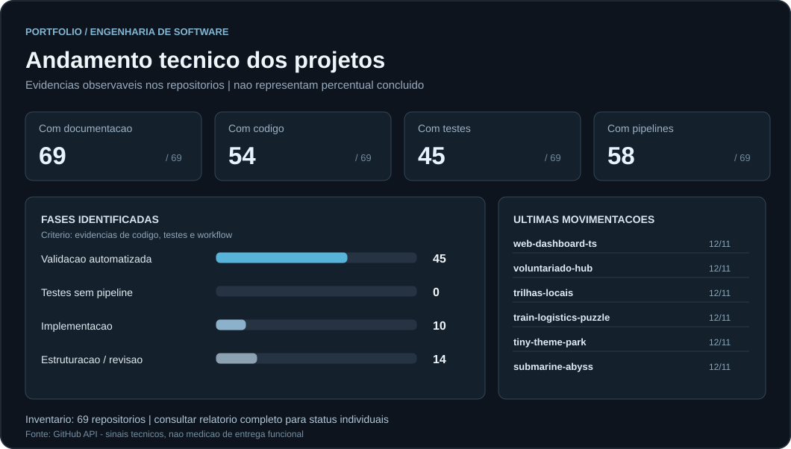

  

 

  <strong>João Júnior</strong> · Engenharia de Software em formação

  
Desenvolvendo soluções modernas com foco em aplicações web, APIs, automação e arquitetura de software.

<!-- STUDY-SUPPORT:START -->

  <a href="./assets/pix-estudos-qr.svg" title="Abrir QR Code Pix em tamanho maior">
    <picture>
      <source media="(max-width: 767px)" srcset="./assets/apoie-meus-estudos-mobile.svg" />
      
    </picture>
  </a>

<!-- STUDY-SUPPORT:END -->

<h3 align="center">Principais Tecnologias</h3>

<table align="center">
  <tr>
    <th align="center" width="35%">Front-end</th>
    <th align="center" width="38%">Back-end &amp; APIs</th>
    <th align="center" width="27%">Cloud &amp; DevOps</th>
  </tr>
  <tr>
    <td align="center">
      
    </td>
    <td align="center">
      
    </td>
    <td align="center">
      
    </td>
  </tr>
</table>

<!-- CONTRIBUTIONS:START -->

<!-- CONTRIBUTIONS:METRICS <strong>232</strong><strong>24</strong><strong>837</strong><strong>2.457</strong> -->

<!-- CONTRIBUTIONS:END -->

<!-- PORTFOLIO-STATUS:START -->

  <h2>Andamento dos projetos</h2>
  
Visao tecnica de documentacao, codigo, testes e automacao — sem percentuais inventados.

  
  
<a href="docs/ANDAMENTO_DOS_PROJETOS.md"><strong>Ver andamento individual de todos os projetos</strong></a>

<!-- PORTFOLIO-STATUS:END -->
