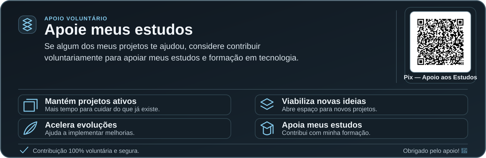

  

 

  <strong>João Júnior</strong> · Engenharia de Software em formação

  
Desenvolvendo soluções modernas com foco em aplicações web, APIs, automação e arquitetura de software.

<!-- STUDY-SUPPORT:START -->

  <a href="./assets/pix-estudos-qr.svg" title="Abrir QR Code Pix em tamanho maior">
    <picture>
      <source media="(max-width: 767px)" srcset="./assets/apoie-meus-estudos-mobile.svg" />
      
    </picture>
  </a>

<!-- STUDY-SUPPORT:END -->

<h3 align="center">Principais Tecnologias</h3>

<table align="center">
  <tr>
    <th align="center" width="35%">Front-end</th>
    <th align="center" width="38%">Back-end &amp; APIs</th>
    <th align="center" width="27%">Cloud &amp; DevOps</th>
  </tr>
  <tr>
    <td align="center">
      
    </td>
    <td align="center">
      
    </td>
    <td align="center">
      
    </td>
  </tr>
</table>

<!-- CONTRIBUTIONS:START -->

<!-- CONTRIBUTIONS:METRICS <strong>228</strong><strong>24</strong><strong>833</strong><strong>2.453</strong> -->

Ver contribuições por dia — últimos 14 dias

| Data (RN) | Contribuições |
| :--- | ---: |
| 12/11/2026 | 228 |
| 11/11/2026 | 24 |
| 10/11/2026 | 123 |
| 09/11/2026 | 111 |
| 08/11/2026 | 142 |
| 07/11/2026 | 91 |
| 06/11/2026 | 114 |
| 05/11/2026 | 166 |
| 04/11/2026 | 80 |
| 03/11/2026 | 227 |
| 02/11/2026 | 553 |
| 01/11/2026 | 428 |
| 31/10/2026 | 2 |
| 30/10/2026 | 5 |

Análise complementar — dias da semana e ranking

| Dia da semana | Contribuições nos 14 dias |
| :--- | ---: |
| Segunda | 664 |
| Terça | 350 |
| Quarta | 104 |
| Quinta | 394 |
| Sexta | 119 |
| Sábado | 93 |
| Domingo | 570 |

Cinco dias mais ativos na janela:

| Posição | Data | Contribuições |
| ---: | :--- | ---: |
| 1 | 02/11/2026 | 553 |
| 2 | 01/11/2026 | 428 |
| 3 | 12/11/2026 | 228 |
| 4 | 03/11/2026 | 227 |
| 5 | 05/11/2026 | 166 |

Dados de 12/11/2026. Consulta programada a cada 5 minutos, sujeita a atrasos do GitHub. O painel externo deve buscar o JSON atualizado independentemente. <a href="https://github.com/juniordev830/juniordev830/actions/workflows/contribuicoes-diarias.yml">Ver última execução</a>.

Links dos projetos em destaque

<a href="https://github.com/juniordev830/plataforma-de-recrutamento">Plataforma de Recrutamento</a> · 
<a href="https://github.com/juniordev830/sentinel-atlas">Atlas Sentinela</a> · 
<a href="https://github.com/juniordev830/controle-gastos-residenciais">Controle de Gastos</a>

<!-- CONTRIBUTIONS:END -->

<!-- ENGINEERING-JOURNAL:START -->

ENGENHARIA DE SOFTWARE · NOTAS DE DESENVOLVIMENTO

<h2>DEV.LOG</h2>

O que existe por trás dos commits: problemas encontrados, decisões técnicas e entregas verificáveis.

<table>
  <tr>
    <td width="50%" valign="top">
      <strong>01 · Investigar</strong>
      
Entender o comportamento, localizar a causa e definir o que precisa melhorar.

    </td>
    <td width="50%" valign="top">
      <strong>02 · Construir</strong>
      
Implementar mudanças pequenas, úteis e fáceis de revisar.

    </td>
  </tr>
  <tr>
    <td valign="top">
      <strong>03 · Validar</strong>
      
Testar casos relevantes e verificar regressões antes de integrar.

    </td>
    <td valign="top">
      <strong>04 · Documentar</strong>
      
Registrar decisões, limitações e próximos passos de cada projeto.

    </td>
  </tr>
</table>

### Notas de entrega

Seleção de melhorias mescladas em 12/11/2026. Links para os PRs originais, sem números artificiais.

| Área | Problema resolvido · alteração |
| :-- | :-- |
| **Confiabilidade** | [Validar pacote Windows e publicar checksum SHA-256](https://github.com/juniordev830/pixel-farm-seasons/pull/33) · `pixel-farm-seasons` |
| **Regras de jogo** | [Limitar energia e saciedade ao intervalo de 0 a 100](https://github.com/juniordev830/pixel-farm-seasons/pull/32) · `pixel-farm-seasons` |
| **Infraestrutura** | [Adicionar governança de custos e alertas ao laboratório Terraform](https://github.com/juniordev830/infrastructure-as-code-lab/pull/5) · `infrastructure-as-code-lab` |

  <a href="https://github.com/pulls?q=author%3Ajuniordev830+is%3Apr+is%3Amerged"><strong>Histórico completo de entregas</strong></a>
  &nbsp;·&nbsp;
  <a href="https://github.com/juniordev830?tab=repositories">Repositórios</a>
  &nbsp;·&nbsp;
  <a href="docs/MANUTENCAO_DO_PERFIL.md">Notas técnicas do perfil</a>
  &nbsp;·&nbsp;
  <a href="https://joao-github-dashboard.joaosilva42333.chatgpt.site">Painel de dados</a>

<!-- ENGINEERING-JOURNAL:END -->
