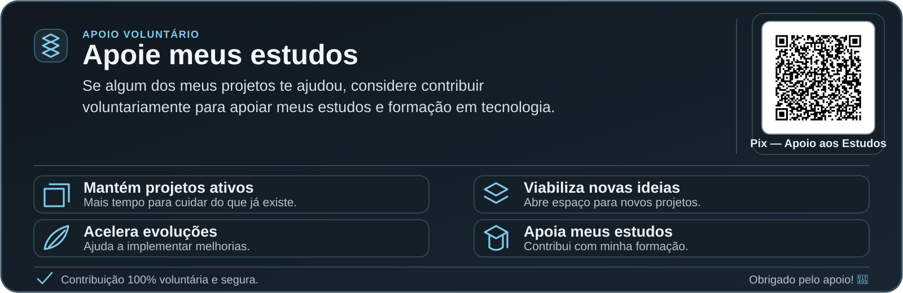
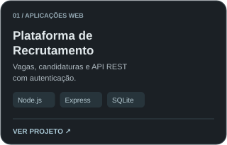
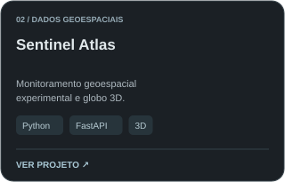
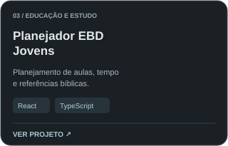
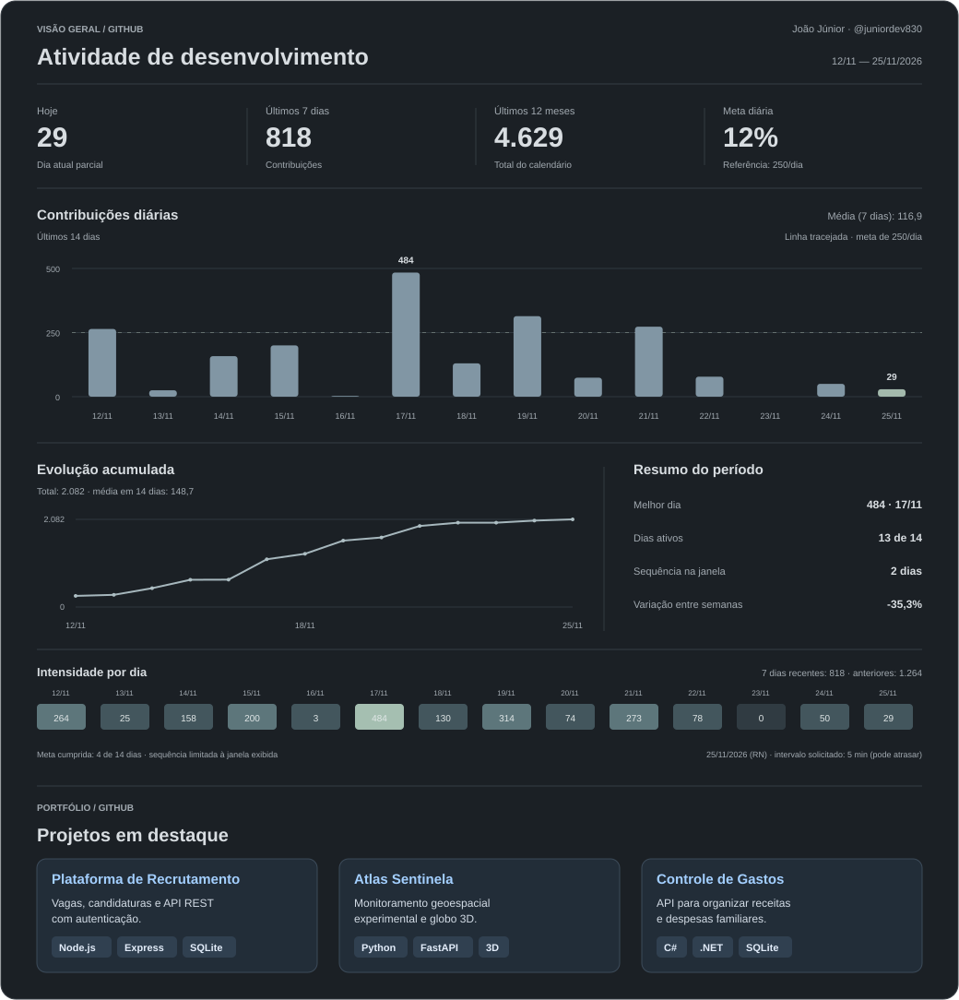
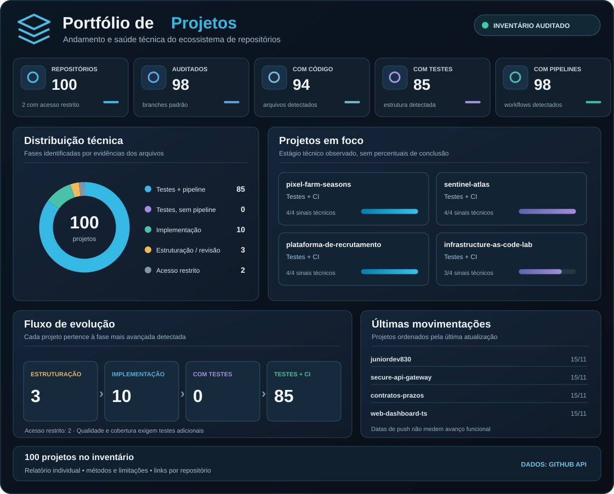

  

 

  <strong>João Júnior</strong> · Engenharia de Software em formação

  
Desenvolvendo soluções modernas com foco em aplicações web, APIs, automação e arquitetura de software.

<!-- STUDY-SUPPORT:START -->

  <a href="./assets/pix-estudos-qr.svg" title="Abrir QR Code Pix em tamanho maior">
    <picture>
      <source media="(max-width: 767px)" srcset="./assets/apoie-meus-estudos-mobile.svg" />
      
    </picture>
  </a>

<!-- STUDY-SUPPORT:END -->

<h3 align="center">Principais Tecnologias</h3>

<table align="center">
  <tr>
    <th align="center" width="35%">Front-end</th>
    <th align="center" width="38%">Back-end &amp; APIs</th>
    <th align="center" width="27%">Cloud &amp; DevOps</th>
  </tr>
  <tr>
    <td align="center">
      
    </td>
    <td align="center">
      
    </td>
    <td align="center">
      
    </td>
  </tr>
</table>

## Projetos em destaque

  
  
  

<!-- CONTRIBUTIONS:START -->

<!-- CONTRIBUTIONS:METRICS <strong>0</strong><strong>1</strong><strong>435</strong><strong>4.634</strong> -->

<!-- CONTRIBUTIONS:END -->

<!-- PORTFOLIO-STATUS:START -->

  <h2>Portfólio de Projetos</h2>
  
Visão executiva de estágio técnico, validação e últimas movimentações dos repositórios.

  
  
<a href="docs/ANDAMENTO_DOS_PROJETOS.md"><strong>Consultar detalhes dos projetos</strong></a>

<!-- PORTFOLIO-STATUS:END -->

<!-- PROJECT-MAP:START -->

  <h2>Mapa dos meus projetos</h2>
  
100 repositórios · 7 áreas · 17 subáreas

  
Abra uma área e expanda cada subárea para explorar os projetos. São 98 projetos públicos e 2 privados.

<strong>01 · Engenharia de Software, APIs e Infraestrutura</strong> — 20 projetos · 1 privado

<strong>Back-end e serviços</strong> · 8 projetos

- [ai-service-python](https://github.com/juniordev830/ai-service-python)
- [auth-service-go](https://github.com/juniordev830/auth-service-go)
- [payment-service-java](https://github.com/juniordev830/payment-service-java)
- [order-service-csharp](https://github.com/juniordev830/order-service-csharp)
- [secure-api-gateway](https://github.com/juniordev830/secure-api-gateway)
- [distributed-task-queue](https://github.com/juniordev830/distributed-task-queue)
- [feature-flags-service](https://github.com/juniordev830/feature-flags-service)
- [database-migration-auditor](https://github.com/juniordev830/database-migration-auditor)

<strong>DevOps, segurança e observabilidade</strong> · 7 projetos

- [devops-control-center](https://github.com/juniordev830/devops-control-center)
- [code-security-scanner](https://github.com/juniordev830/code-security-scanner)
- [observability-platform](https://github.com/juniordev830/observability-platform)
- [infrastructure-as-code-lab](https://github.com/juniordev830/infrastructure-as-code-lab)
- [api-test-studio](https://github.com/juniordev830/api-test-studio)
- [ai-incident-analyzer](https://github.com/juniordev830/ai-incident-analyzer)
- [sentinel-atlas](https://github.com/juniordev830/sentinel-atlas)

<strong>Interfaces, IA e ferramentas técnicas</strong> · 5 projetos

- [web-dashboard-ts](https://github.com/juniordev830/web-dashboard-ts)
- [codax-assirtende-engenharia-ia-](https://github.com/juniordev830/codax-assirtende-engenharia-ia-)
- [arduino-lab](https://github.com/juniordev830/arduino-lab)
- [comparador-json](https://github.com/juniordev830/comparador-json)
- *1 projeto privado*

<strong>02 · Negócios, Sistemas de Gestão e Serviços</strong> — 16 projetos

<strong>Finanças, PJ e contratos</strong> · 4 projetos

- [auxiliar-NF-pj](https://github.com/juniordev830/auxiliar-NF-pj)
- [relatorio-altomatizado-de-contas-](https://github.com/juniordev830/relatorio-altomatizado-de-contas-)
- [orcamento-freelancer](https://github.com/juniordev830/orcamento-freelancer)
- [contratos-prazos](https://github.com/juniordev830/contratos-prazos)

<strong>Vendas, RH e atendimento</strong> · 7 projetos

- [plataforma-de-recrutamento](https://github.com/juniordev830/plataforma-de-recrutamento)
- [site-e-commerce-](https://github.com/juniordev830/site-e-commerce-)
- [food-intelligence-](https://github.com/juniordev830/food-intelligence-)
- [agenda-servicos](https://github.com/juniordev830/agenda-servicos)
- [helpdesk-suporte](https://github.com/juniordev830/helpdesk-suporte)
- [fila-atendimento](https://github.com/juniordev830/fila-atendimento)
- [candidaturas-tracker](https://github.com/juniordev830/candidaturas-tracker)

<strong>Operações, equipes e patrimônio</strong> · 5 projetos

- [oficina-digital](https://github.com/juniordev830/oficina-digital)
- [estoque-rastreavel](https://github.com/juniordev830/estoque-rastreavel)
- [reserva-salas](https://github.com/juniordev830/reserva-salas)
- [escala-equipes](https://github.com/juniordev830/escala-equipes)
- [garantias-compras](https://github.com/juniordev830/garantias-compras)

<strong>03 · Jogos e Simulações</strong> — 16 projetos

<strong>Ação, arcade e esportes</strong> · 8 projetos

- [corrida-maluca-](https://github.com/juniordev830/corrida-maluca-)
- [2d-platformer-csharp](https://github.com/juniordev830/2d-platformer-csharp)
- [space-shooter-js](https://github.com/juniordev830/space-shooter-js)
- [retro-arcade-cpp](https://github.com/juniordev830/retro-arcade-cpp)
- [robot-arena-duel](https://github.com/juniordev830/robot-arena-duel)
- [space-miner-2d](https://github.com/juniordev830/space-miner-2d)
- [submarine-abyss](https://github.com/juniordev830/submarine-abyss)
- [rally-dunas-rn](https://github.com/juniordev830/rally-dunas-rn)

<strong>RPG e narrativas</strong> · 2 projetos

- [rpg-quest-python](https://github.com/juniordev830/rpg-quest-python)
- [cyber-detective-noir](https://github.com/juniordev830/cyber-detective-noir)

<strong>Simulação, estratégia e puzzles</strong> · 6 projetos

- [puzzle-adventure-ts](https://github.com/juniordev830/puzzle-adventure-ts)
- [pixel-farm-seasons](https://github.com/juniordev830/pixel-farm-seasons)
- [airport-control-mini](https://github.com/juniordev830/airport-control-mini)
- [tiny-theme-park](https://github.com/juniordev830/tiny-theme-park)
- [train-logistics-puzzle](https://github.com/juniordev830/train-logistics-puzzle)
- [physics-lab-playground](https://github.com/juniordev830/physics-lab-playground)

<strong>04 · Bíblia, Teologia, EBD e Pregação</strong> — 23 projetos · 1 privado

<strong>Fontes, pesquisa e interpretação bíblica</strong> · 13 projetos

- [concordancia-biblica](https://github.com/juniordev830/concordancia-biblica)
- [panorama-biblico-interativo](https://github.com/juniordev830/panorama-biblico-interativo)
- [grego-hebraico-biblico](https://github.com/juniordev830/grego-hebraico-biblico)
- [atlas-biblico-digital](https://github.com/juniordev830/atlas-biblico-digital)
- [referencias-cruzadas-biblia](https://github.com/juniordev830/referencias-cruzadas-biblia)
- [laboratorio-hermeneutica](https://github.com/juniordev830/laboratorio-hermeneutica)
- [estudo-pericopes-biblicas](https://github.com/juniordev830/estudo-pericopes-biblicas)
- [temas-e-contexto-biblico](https://github.com/juniordev830/temas-e-contexto-biblico)
- [estudo-biblico-paralelos](https://github.com/juniordev830/estudo-biblico-paralelos)
- [catalogo-comentarios-biblicos](https://github.com/juniordev830/catalogo-comentarios-biblicos)
- [fichamento-comentario-biblico](https://github.com/juniordev830/fichamento-comentario-biblico)
- [matriz-interpretacoes-biblicas](https://github.com/juniordev830/matriz-interpretacoes-biblicas)
- *1 projeto privado*

<strong>EBD, leitura e devocionais</strong> · 6 projetos

- [ebd-planejador](https://github.com/juniordev830/ebd-planejador)
- [biblia-plano-de-leitura](https://github.com/juniordev830/biblia-plano-de-leitura)
- [ebd-jovens-planner](https://github.com/juniordev830/ebd-jovens-planner)
- [quiz-biblico-interativo](https://github.com/juniordev830/quiz-biblico-interativo)
- [diario-devocional](https://github.com/juniordev830/diario-devocional)
- [roteiro-grupo-biblico](https://github.com/juniordev830/roteiro-grupo-biblico)

<strong>Pregação e sermões</strong> · 4 projetos

- [esboco-pregacao-expositiva](https://github.com/juniordev830/esboco-pregacao-expositiva)
- [ensaio-tempo-sermao](https://github.com/juniordev830/ensaio-tempo-sermao)
- [series-de-pregacao](https://github.com/juniordev830/series-de-pregacao)
- [ilustracoes-para-pregacao](https://github.com/juniordev830/ilustracoes-para-pregacao)

<strong>05 · Mobilidade Urbana, Transporte e Mapas</strong> — 12 projetos

<strong>Trânsito e transporte inteligente</strong> · 8 projetos

- [mobilidade-rotas-rn](https://github.com/juniordev830/mobilidade-rotas-rn)
- [transito-horarios-rn](https://github.com/juniordev830/transito-horarios-rn)
- [transporte-multimodal-natal](https://github.com/juniordev830/transporte-multimodal-natal)
- [mapa-acessibilidade-urbana](https://github.com/juniordev830/mapa-acessibilidade-urbana)
- [estacionamento-ultima-milha](https://github.com/juniordev830/estacionamento-ultima-milha)
- [mapa-ocorrencias-transito](https://github.com/juniordev830/mapa-ocorrencias-transito)
- [entregas-rotas-por-turno](https://github.com/juniordev830/entregas-rotas-por-turno)
- [transito-google-routes-rn](https://github.com/juniordev830/transito-google-routes-rn)

<strong>Território e deslocamentos</strong> · 4 projetos

- [catalogo-municipios](https://github.com/juniordev830/catalogo-municipios)
- [trilhas-locais](https://github.com/juniordev830/trilhas-locais)
- [divide-viagem](https://github.com/juniordev830/divide-viagem)
- [bike-care](https://github.com/juniordev830/bike-care)

<strong>06 · Produtividade, Estudos e Comunidade</strong> — 12 projetos

<strong>Aprendizagem e organização pessoal</strong> · 6 projetos

- [cifras-transpositor](https://github.com/juniordev830/cifras-transpositor)
- [revisao-espacada](https://github.com/juniordev830/revisao-espacada)
- [quiz-sala](https://github.com/juniordev830/quiz-sala)
- [caderno-offline](https://github.com/juniordev830/caderno-offline)
- [diario-leitura](https://github.com/juniordev830/diario-leitura)
- [documentos-validade](https://github.com/juniordev830/documentos-validade)

<strong>Casa, acessibilidade e comunidade</strong> · 6 projetos

- [despensa-validades](https://github.com/juniordev830/despensa-validades)
- [consumo-energia](https://github.com/juniordev830/consumo-energia)
- [acessibilidade-checklist](https://github.com/juniordev830/acessibilidade-checklist)
- [achados-perdidos](https://github.com/juniordev830/achados-perdidos)
- [voluntariado-hub](https://github.com/juniordev830/voluntariado-hub)
- [empresta-comunidade](https://github.com/juniordev830/empresta-comunidade)

<strong>07 · Identidade Profissional e Portfólio</strong> — 1 projeto

<strong>Perfil GitHub</strong> · 1 projeto

- [juniordev830](https://github.com/juniordev830/juniordev830)

<!-- PROJECT-MAP:END -->
