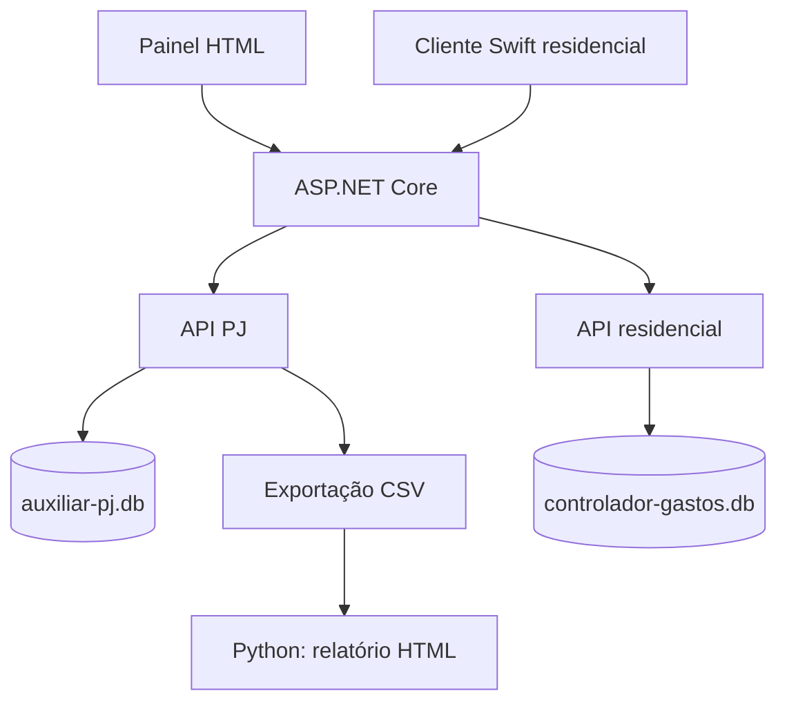

# Catálogo técnico — parte 01

Levantamento inicial dos READMEs na branch padrão. Os textos são declarações do projeto, não confirmação do comportamento em execução. A análise de código integral permanece pendente.

## 2d-platformer-csharp

[Repositório](https://github.com/juniordev830/2d-platformer-csharp) · [README original](https://github.com/juniordev830/2d-platformer-csharp/blob/main/README.md) · branch `main` · blob README `d4eb849091f6`

### Contexto e propósito declarado
# 2D Platformer C#

## Visão geral

Este repositório contém um protótipo de engine 2D com física básica, gravidade, salto e detecção de colisão por bounding box (AABB). O projeto foi implementado em C# com .NET 8 e serve como estudo de mecânica de jogo, otimização de hot path e lógica de colisão.

## Tecnologias e arquitetura

- Linguagem: C#
- Runtime: .NET 8
- Aplicação: console app (`OutputType=Exe`)
- Estruturas principais:
  - `Vector2D` — vetor 2D imutável para física e movimentação
  - `Rect` — retângulo para colisão e limites
  - `Player` — posicionamento, velocidade, salto e estado do personagem
  - `GameSimulation` — fluxo principal de execução da simulação

## Estrutura do projeto

- `Program.cs` — entrada da aplicação
- `GameSimulation.cs` — loop principal da simulação
- `Player.cs` — lógica do player
- `Vector2D.cs` — tipo matemático de vetor
- `Rect.cs` — tipo de colisão
- `PlatformerGame.csproj` — configuração do projeto .NET
- `.gitignore` — arquivos locais gerados pelo

### Especificações técnicas documentadas
**Visão geral**

Este repositório contém um protótipo de engine 2D com física básica, gravidade, salto e detecção de colisão por bounding box (AABB). O projeto foi implementado em C# com .NET 8 e serve como estudo de mecânica de jogo, otimização de hot path e lógica de colisão.

**Tecnologias e arquitetura**

- Linguagem: C#
- Runtime: .NET 8
- Aplicação: console app (`OutputType=Exe`)
- Estruturas principais:
  - `Vector2D` — vetor 2D imutável para física e movimentação
  - `Rect` — retângulo para colisão e limites
  - `Player` — posicionamento, velocidade, salto e estado do personagem
  - `GameSimulation` — fluxo principal de execução da simulação

**Estrutura do projeto**

- `Program.cs` — entrada da aplicação
- `GameSimulation.cs` — loop principal da simulação
- `Player.cs` — lógica do player
- `Vector2D.cs` — tipo matemático de vetor
- `Rect.cs` — tipo de colisão
- `PlatformerGame.csproj` — configuração do projeto .NET
- `.gitignore` — arquivos locais gerados pelo ambiente e IDE
- `README.md` — documentação do projeto
- `docs/AUDITORIA_TECNICA.md` — relatório técnico de auditoria
- `tests/PlatformerGame.Tests/` — testes automatizados da lógica principal

**Como executar**

```bash
dotnet build
dotnet run --project PlatformerGame.csproj
```

**Como executar os testes**

```bash
dotnet test tests/PlatformerGame.Tests/PlatformerGame.Tests.csproj
```

**Limitações conhecidas**

- O código é voltado para protótipo e não para produto de alto porte.
- O workflow de CI executa build e testes em pushes e pull requests.
- A suíte de testes cobre vetores, colisões AABB, validação de dimensões, gravidade, aterrissagem e salto.
- O uso de `float` é adequado ao protótipo, mas pode exigir validações adicionais em cenários mais exigentes.

**Próxima evolução recomendada**

A próxima etapa mais útil é manter a suíte de testes automatizados para regressões de comportamento e desempenho.

### Roteiro de engenharia reversa
Confirmar os módulos e pontos de entrada citados, seguir as chamadas e contratos de dados, verificar as proteções e testar o fluxo principal. A descrição acima é baseada na documentação existente, não em execução independente.


---

## acessibilidade-checklist

[Repositório](https://github.com/juniordev830/acessibilidade-checklist) · [README original](https://github.com/juniordev830/acessibilidade-checklist/blob/main/README.md) · branch `main` · blob README `0a90fa013879`

### Contexto e propósito declarado
Ferramenta local em **TypeScript** para documentar verificacoes **manuais** de acessibilidade. Valida entradas, organiza evidencias, compara revisoes e exporta relatorios sem transmitir dados a servicos externos.

### Especificações técnicas documentadas
**Recursos**

- Cadastro de pagina, data, verificacoes com IDs unicos, status e evidencia.
- Validacao de datas reais, tamanho dos campos e limite de 100 verificacoes por avaliacao.
- Exportacao Markdown com escape de caracteres de formatacao.
- Exportacao CSV RFC4180 com protecao contra interpretacao de formulas por planilhas.
- Relatorio JSON com indicadores globais, agrupamento por prefixo do ID, paginacao e alertas de qualidade.
- Busca por texto sem diferenciar acentos e maiusculas, filtro por estado, ordenacao e paginacao.
- Comparacao de duas avaliacoes da **mesma pagina**: melhorias, regressoes, mudancas de aplicabilidade, inclusoes e exclusoes.
- Diagnostico de evidencias ausentes/curtas e titulos possivelmente duplicados.
- Testes automatizados Node.js e compilacao TypeScript estrita.

**Executar**

Requer Node.js 22+ e npm. Dados de exemplo ficticios:

```bash
npm install
npm test
node dist/cli.js examples/avaliacao.json
node dist/cli.js examples/avaliacao.json --format=csv > checklist.csv
node dist/cli.js examples/avaliacao.json --format=json --status=pendente --limit=20 > pendencias.json
node dist/cli.js examples/avaliacao.json --query=teclado --sort=titulo --direction=desc
node dist/cli.js atual.json --compare=anterior.json > evolucao.md
```

Opcoes: `--format=markdown|csv|json`, `--status=aprovado|pendente|nao_aplicavel`, `--query=texto`, `--sort=id|titulo|status`, `--direction=asc|desc` (ordem crescente ou decrescente), `--offset=N`, `--limit=N` (1 a 100), `--compare=arquivo.json`. O formato padrao e Markdown. Comparacoes nao aceitam filtros ou formatos alternativos.

O campo `id` pode usar prefixos como `form:rotulos` e `midia:legendas` para agrupar criterios. IDs precisam permanecer estaveis entre revisoes para comparacoes confiaveis.

**Proximos passos**

Interface web, armazenamento editavel, trilha de revisoes assinada e mapeamento assistido de criterios WCAG podem ser implementados em evolucoes futuras.

### Roteiro de engenharia reversa
Confirmar os módulos e pontos de entrada citados, seguir as chamadas e contratos de dados, verificar as proteções e testar o fluxo principal. A descrição acima é baseada na documentação existente, não em execução independente.


---

## achados-perdidos

[Repositório](https://github.com/juniordev830/achados-perdidos) · [README original](https://github.com/juniordev830/achados-perdidos/blob/main/README.md) · branch `main` · blob README `d5dc7c9407b4`

### Contexto e propósito declarado
MVP em PHP 8.2+ para registrar objetos encontrados em ambientes comunitários sem incluir dados pessoais de proprietários.

### Especificações técnicas documentadas
**Funcionalidades**

- Cadastro de objetos com identificador, descrição genérica, categoria e data.
- Lista de pendentes, registro de devoluções e histórico preservado.
- Validação de IDs, datas e devoluções; persistência JSON por substituição atômica e bloqueio de escrita entre processos CLI.
- Relatórios somente leitura com filtros por status, categoria, período e texto, além de ordenação e paginação.
- Indicadores de pendências, devoluções, taxa de devolução, idade das pendências e distribuições por categoria/mês.
- Histórico cronológico de encontros e devoluções.
- CSV com neutralização de células que podem ser interpretadas como fórmulas em planilhas.

**Cadastro e devolução**

O comando main.php continua responsável pela escrita e é compatível com o arquivo JSON anterior.

    php main.php adicionar dados.json chaves-1 "Chaveiro simples" objetos 2026-11-08
    php main.php adicionar dados.json roupas-1 "Blusa azul" roupas 2026-11-08
    php main.php pendentes dados.json
    php main.php devolver dados.json chaves-1 2026-11-08
    php main.php todos dados.json

**Testes**

php -l main.php
    php -l reports.php
    php -l src/CatalogReports.php
    php -l tests/ReportsTest.php
    php main.php --self-test
    php tests/ConcurrentWritesTest.php
    php tests/ReportsTest.php

O GitHub Actions executa lint, autoteste e as suítes de relatórios, operações e recibos em PHP 8.2, 8.3 e 8.4.

### Roteiro de engenharia reversa
Confirmar os módulos e pontos de entrada citados, seguir as chamadas e contratos de dados, verificar as proteções e testar o fluxo principal. A descrição acima é baseada na documentação existente, não em execução independente.


---

## agenda-servicos

[Repositório](https://github.com/juniordev830/agenda-servicos) · [README original](https://github.com/juniordev830/agenda-servicos/blob/main/README.md) · branch `main` · blob README `901cdb55a429`

### Contexto e propósito declarado
Biblioteca de domínio em **Java 17**, sem dependências de produção, para agendamentos de serviços. O módulo original `AgendaService` continua disponível e mantém a mesma API; a expansão adiciona recursos independentes para catálogos, múltiplos profissionais e relatórios.

[](https://github.com/juniordev830/agenda-servicos/actions)

### Especificações técnicas documentadas
**Funcionalidades**

- **Catálogo:** cadastro e atualização de serviços, duração validada em minutos, preço inteiro em centavos, pesquisa, ativação e desativação.
- **Calendário de trabalho:** expediente por dia da semana, múltiplos turnos com pausa, feriados, bloqueios excepcionais e geração de candidatos para reservas.
- **Agenda multiprofissional:** reservas com IDs estáveis, preços históricos, isolamento entre profissionais, conflito de horários, cancelamento auditável e reagendamento atômico.
- **Disponibilidade:** intervalos semiabertos `[início, fim)`, slots configuráveis e busca do primeiro horário em até 366 dias.
- **Consultas e indicadores:** reservas por profissional, cliente, período e dia; ocupação, minutos reservados e receita prevista.
- **Exportação:** CSV com aspas e mitigação de injeção de fórmulas em planilhas; iCalendar com escape de caracteres e exclusão de cancelamentos.

**Testes e CI**

```sh
mvn -B test
```

O projeto usa JUnit 5 e GitHub Actions. Os testes cobrem validações, conflitos, horários adjacentes, concorrência sequencial por operação sincronizada, calendários, cancelamentos, reagendamentos, filtros e exportações. A API original permanece coberta por seus testes anteriores.

**Limites e decisões**

1. A aplicação **não** persiste reservas nem expõe endpoints HTTP. Os dados existem apenas durante a execução do processo.
2. Os calendários e reservas usam `LocalDateTime`; o sistema consumidor deve definir e documentar seu fuso horário. O arquivo ICS usa horários locais, sem declarar UTC.
3. O controle de concorrência é sincronizado em cada instância de `AgendaProfissionais`; não substitui transações de banco de dados entre processos.
4. Alterar um serviço não modifica preço ou duração de reservas já registradas. Bloqueios adicionados depois de reservas existentes não cancelam automaticamente esses agendamentos.
5. O percentual de ocupação considera a duração do expediente configurado, sem descontar pausas extraordinárias. O relatório financeiro representa **receita prevista**, não pagamentos recebidos.
6. O CSV exportado é para planilhas; não é um formato de backup/importação. Evite exportar dados pessoais sem base legal e controle de acesso.

O módulo original de agendamento simples continua em `AgendaService` e `Agendamento`, sem mudança de comportamento. Todos os exemplos usam dados fictícios.

### Roteiro de engenharia reversa
Confirmar os módulos e pontos de entrada citados, seguir as chamadas e contratos de dados, verificar as proteções e testar o fluxo principal. A descrição acima é baseada na documentação existente, não em execução independente.


---

## ai-incident-analyzer

[Repositório](https://github.com/juniordev830/ai-incident-analyzer) · [README original](https://github.com/juniordev830/ai-incident-analyzer/blob/main/README.md) · branch `main` · blob README `afb868429962`

### Contexto e propósito declarado
Detector estatístico de anomalias de latência a partir de CSV de logs (`service,latency_ms`), com baseline por serviço e escore z. **Este MVP usa estatística descritiva, não modelo de IA treinado**.

### Especificações técnicas documentadas
**Como executar**

```bash
python analyzer.py examples/latencies.csv
python analyzer.py examples/latencies.csv --threshold 2.3
```

Use `--threshold` para definir o escore z mínimo. O padrão é 2,5 e o valor deve ser positivo e finito. Ajustar o limiar altera a sensibilidade e deve ser validado com dados representativos.

**Testes**

```bash
python -m unittest discover -s tests -v
```

O GitHub Actions executa os testes automaticamente em pushes e pull requests.

**Segurança e limitações**

Não recebe telemetria remota nem logs com PII. Z-score pode falhar com tendências, picos e distribuição assimétrica; precisa de janela temporal e validação antes de alertas reais.

**Evolução planejada**

Integrar coleta OpenTelemetry, Isolation Forest ou modelos apropriados, precisão/recall e dashboard de incidentes.

---
Projeto de Engenharia de Software mantido na conta [juniordev830](https://github.com/juniordev830).

### Roteiro de engenharia reversa
Confirmar os módulos e pontos de entrada citados, seguir as chamadas e contratos de dados, verificar as proteções e testar o fluxo principal. A descrição acima é baseada na documentação existente, não em execução independente.


---

## ai-service-python

[Repositório](https://github.com/juniordev830/ai-service-python) · [README original](https://github.com/juniordev830/ai-service-python/blob/main/README.md) · branch `main` · blob README `616443dd2583`

### Contexto e propósito declarado
Módulo Python experimental para análise básica de texto e processamento em lote. O ponto de entrada `src/main.py` é uma biblioteca/exemplo executável por terminal. O analisador usa apenas a biblioteca padrão; `requirements.txt` contém a dependência de testes.

### Especificações técnicas documentadas
**Funcionalidades atuais**

- Rejeita texto vazio.
- Remove espaços externos.
- Conta palavras.
- Estima sentimento por um pequeno léxico positivo/negativo em inglês e português.
- Trata acentos Unicode compostos e decompostos de forma equivalente, preservando o texto original na resposta (exceto espaços externos).
- Considera negações simples (`not`, `never`, `não`, `nao`, `nunca`) e contrações comuns em inglês (`don't`, `isn't`, `can't`) em uma janela curta e reinicia o escopo em pontuação, incluindo variantes de largura completa, ou conectores de contraste. Identificadores como `good_news` e `bom2` são tratados como tokens inteiros.
- Informa um escore heurístico (`confidence`) e o método usado; esse escore não é uma probabilidade calibrada.
- Processa uma lista de textos, ignorando itens vazios. Cada texto pode ter até **10.000 caracteres** e cada lote pode conter até **100 itens**, para limitar o trabalho por chamada.

O limite de caracteres é conferido na entrada original, inclusive em itens
compostos apenas por espaços, antes de ignorá-los ou normalizar seus acentos.

> O rótulo de sentimento e a confiança são regras didáticas, não previsões de um modelo de Machine Learning validado. Não use os resulta

**Executar o exemplo**

```bash
python src/main.py
```

**Testes**

```bash
pytest
```

**Estrutura**

```text
.
├── src/main.py
├── tests/
├── requirements.txt
└── README.md
```

**Próximas melhorias**

- Ampliar e versionar o léxico e melhorar o tratamento de expressões, ironia, negações compostas e conectores de contraste.
- Adicionar testes para entrada vazia, espaços, texto curto e lote misto.
- Se for necessário expor HTTP, criar uma aplicação FastAPI explícita com schemas Pydantic e documentação dos endpoints.
- Substituir as heurísticas por um método avaliado e documentar métricas antes de chamá-lo de modelo de IA.

Projeto de aprendizagem em evolução.

### Roteiro de engenharia reversa
Confirmar os módulos e pontos de entrada citados, seguir as chamadas e contratos de dados, verificar as proteções e testar o fluxo principal. A descrição acima é baseada na documentação existente, não em execução independente.


---

## airport-control-mini

[Repositório](https://github.com/juniordev830/airport-control-mini) · [README original](https://github.com/juniordev830/airport-control-mini/blob/main/README.md) · branch `main` · blob README `406c50b65019`

### Contexto e propósito declarado
# Airport Control Mini

## Jogo de navegador em Phaser

**Status:** primeiro MVP gráfico para navegador. É um **jogo fictício**, não um sistema operacional de tráfego aéreo.

### O que faz
- Radar 2D, pistas e aviões com trajetórias de aproximação.
- Clique ou toque em um avião amarelo para conceder autorização de pouso (vira verde).
- Acompanhe pousos, voos em aproximação e tentativas sem autorização.
- O desafio é completar 8 pousos antes de acumular 3 incidentes.
- Pressione **R** para reiniciar.

### Tecnologias
TypeScript, Phaser 3, Vite; regras de cálculo separadas do motor gráfico com testes Node.

### Executar
Requer Node.js 20.19+:

```bash
npm install
npm run dev
```

### Validar
```bash
npm test
npm run build
```

Os testes verificam movimento, distância, autorização e condições de vitória/derrota.

### Limites
Este protótipo usa gráficos geométricos, trajetórias simplificadas e dados simulados. Ainda não possui física aérea real, separação vertical, áudio, persistência ou g

### Especificações técnicas documentadas
**Tecnologias**

TypeScript, Phaser 3, Vite; regras de cálculo separadas do motor gráfico com testes Node.

**Executar**

Requer Node.js 20.19+:

```bash
npm install
npm run dev
```

**Próximas melhorias**

- Curvas de aproximação e múltiplas rotas;
- efeitos sonoros, missões e dificuldade escalável;
- controles mais detalhados e melhorias de acessibilidade.

**Protótipo funcional (Python 3.10+)**

O módulo `scheduler.py` agenda operações de pouso e decolagem com intervalos de ocupação por pista. Rejeita conflitos de horários na mesma pista, voos duplicados e operações inválidas. Intervalos consecutivos são permitidos, e pistas diferentes podem operar em paralelo.

Este é um núcleo em memória: não representa separação de segurança operacional, regras ATC reais nem persistência.

**Testes**

```bash
python -m unittest discover -s tests -v
```

O conjunto de testes cobre conflitos, intervalos adjacentes, pistas paralelas, duplicação de voos, validação e consulta por pista.

### Roteiro de engenharia reversa
Confirmar os módulos e pontos de entrada citados, seguir as chamadas e contratos de dados, verificar as proteções e testar o fluxo principal. A descrição acima é baseada na documentação existente, não em execução independente.


---

## api-test-studio

[Repositório](https://github.com/juniordev830/api-test-studio) · [README original](https://github.com/juniordev830/api-test-studio/blob/main/README.md) · branch `main` · blob README `3e5aeaa5b5dd`

### Contexto e propósito declarado
Ferramenta CLI Node.js 22 para verificar status de endpoints REST, sem dependências externas. Timeout de 5 segundos e redirecionamentos desativados.

### Especificações técnicas documentadas
**API Test Studio**

Ferramenta CLI Node.js 22 para verificar status de endpoints REST, sem dependências externas. Timeout de 5 segundos e redirecionamentos desativados.

**Como executar**

```bash
node src/cli.js http://127.0.0.1:3000/health 200
node src/cli.js http://127.0.0.1:3000/health 200 --method HEAD --timeout 2000
node src/cli.js http://127.0.0.1:3000/health 200 --max-duration 500
node src/cli.js http://127.0.0.1:3000/health 200 --content-type application/json
```

O método padrão é `GET`. Use `--method HEAD` para conferir o status sem pedir o corpo da resposta. O parâmetro `--timeout` define o tempo máximo em milissegundos, de 1 a 120000. Use `--max-duration` para exigir que o endpoint responda dentro de um limite (em milissegundos, de 1 a 120000). Quando a resposta ultrapassa esse valor, o resultado inclui `durationPassed: false`, `passed: false` e o CLI termina com código 1. Sem a opção, o comportamento anterior é preservado.

`--timeout` limita quanto tempo a requisição pode levar antes de ser cancelada; `--max-duration` verifica a duração da resposta concluída. É possível usar ambos.

`--content-type MIME` exige o tipo de mídia HTTP informado, por exemplo `application/json`. A comparação ignora letras maiúsculas/minúsculas e parâmetros como `charset=utf-8`; não lê o corpo da resposta. Quando o cabeçalho está ausente ou não corresponde, a saída inclui `co

**Testes**

```bash
npm test
```

O GitHub Actions executa os testes automaticamente em pushes e pull requests.

**Segurança e limitações**

O usuário escolhe a URL; não execute sobre sistemas sem autorização. MVP é CLI para um endpoint por chamada, não é um test runner completo nem interface web.

**Evolução planejada**

Adicionar coleções JSON, assertions de esquema, execução concorrente com limites e frontend React + Playwright.

---
Projeto de Engenharia de Software mantido na conta [juniordev830](https://github.com/juniordev830).

**Coleções de testes HTTP (novo)**

O verificador original de um endpoint continua disponível. O novo runner permite
executar **até 100 cenários** por coleção JSON, com **1 a 8 workers**, tentativas
limitadas (0–3 retries) e relatórios JSON, Markdown ou JUnit XML.

Execute sua API local e depois:

```bash
node src/collection-cli.js --file examples/collection.json
node src/collection-cli.js --file examples/collection.json --concurrency 4 --format markdown
node src/collection-cli.js --file examples/collection.json --format junit --output junit.xml
npm test
```

O exemplo assume endpoints locais em 127.0.0.1:3000; ajuste para sua aplicação.
O runner não inicia servidores nem faz chamadas remotas durante os testes automatizados.
Saída: código 0 para sucesso, 1 para falhas de assertions e 2 para entrada inválida.
`--output` cria um arquivo novo e nunca substitui arquivos existentes. Se o
destino já existir (inclusive links para a entrada), a CLI retorna 2 e pede outro
caminho. Use nomes diferentes para conservar o histórico de execuções.

**Estrutura da coleção**

- `name`: nome da coleção.
- `defaults`: método GET/HEAD, timeoutMs (1–120000), expectedStatus (100–599),
  retries (0–3), retryDelayMs (0–5000) e headers opcionais.
- `cases`: lista de objetos com `id` único, `url` HTTP(S), overrides dos
  defaults e até 30 `assertions` por cenário.

Matchers suportados:

| kind | Campos | Exemplo |
| --- | --- | --- |
| status | equals | `{"kind":"status","equals":200}` |
| header | name, equals/contains/exists | `{"kind":"header","name":"content-type","contains":"json"}` |
| text | equals/contains | `{"kind":"text","contains":"ready"}` |
| json | path, equals/exists/type | `{"kind":"json","path":"/data/0/id","type":"number"}` |
| duration | maxMs | `{"kind":"duration","maxMs":500}` |
| size | minBytes/maxBytes | `{"kind":"size","maxBytes":4096}` |

JSON pointers seguem RFC 6901, incluindo escapes `~0` e `~1`.
Cada cenário compara também o status esperado, mesmo sem assertions explícitas.
O matcher `duration` mede cada tentativa até terminar a leitura do corpo
(em HEAD, apenas até receber os cabeçalhos). A duração total do cenário inclui
as esperas entre tentativas; essas esperas não entram na duração de cada tentativa.
Os relatórios contêm statu

**Limites e segurança**

- Somente GET/HEAD e HTTP(S), sem seguir redirecionamentos.
- URL sem credenciais embutidas ou fragmentos; cabeçalhos de transporte restritos.
- Nomes de cabeçalhos são normalizados para minúsculas: o valor do cenário
  substitui o padrão mesmo com capitalização diferente (`Accept`/`accept`).
  Duplicatas no mesmo objeto são rejeitadas; o limite de 20 cabeçalhos vale
  também após combinar os padrões e o cenário.
- Até 1 MiB de corpo por resposta, interrompendo leitura ao atingir o limite.
- Arquivo JSON regular em UTF-8 até 128 KiB, com campos desconhecidos rejeitados.
  A leitura é limitada antes de interpretar o JSON, inclusive se o arquivo
  crescer durante a operação. UTF-8 inválido é rejeitado sem substituir caracteres.
- O runner **não isola destinos de rede**: não execute coleções não confiáveis,
  nem aponte para serviços sem autorização; URLs de rede interna são permitidas
  intencionalmente para testes locais.
- Repetições são limitadas, com execução apenas de métodos idempotentes.
- JUnit escapa XML e Markdown escapa caracteres de tabela.

### Roteiro de engenharia reversa
Confirmar os módulos e pontos de entrada citados, seguir as chamadas e contratos de dados, verificar as proteções e testar o fluxo principal. A descrição acima é baseada na documentação existente, não em execução independente.


---

## arduino-lab

[Repositório](https://github.com/juniordev830/arduino-lab) · [README original](https://github.com/juniordev830/arduino-lab/blob/main/README.md) · branch `main` · blob README `ef40d27509db`

### Contexto e propósito declarado
Laboratório de experimentos de eletrônica, programação embarcada e automação com Arduino usando **C e C++**.

### Especificações técnicas documentadas
**Boas práticas de segurança**

- Selecione o modelo exato da placa e verifique seus limites elétricos antes de ligar qualquer circuito.
- Não conecte componentes diretamente a uma alimentação sem conferir tensão, corrente e polaridade.
- Nunca conecte a rede elétrica residencial a uma placa Arduino.
- Documente placa, tensão, componentes, pinos e esquema em cada novo experimento.
- Teste o sketch em bancada e mantenha fios e circuitos desligados durante alterações de montagem.

**Estrutura**

```text
experiments/
└── blink/
    ├── blink.ino
    └── README.md
```

**Testes nativos em C**

Sem placa conectada, rode:

```bash
gcc -std=c11 -Wall -Wextra -Werror -pedantic tests/debounce_test.c experiments/button-debounce/debounce.c -o debounce_test
./debounce_test
```

O teste verifica ruídos do botão, acionamento, soltura e o retorno de `millis()` ao zero. O GitHub Actions compila o módulo em C e o sketch para Arduino Uno.

### Roteiro de engenharia reversa
Confirmar os módulos e pontos de entrada citados, seguir as chamadas e contratos de dados, verificar as proteções e testar o fluxo principal. A descrição acima é baseada na documentação existente, não em execução independente.


---

## atlas-biblico-digital

[Repositório](https://github.com/juniordev830/atlas-biblico-digital) · [README original](https://github.com/juniordev830/atlas-biblico-digital/blob/main/README.md) · branch `main` · blob README `8ddda1726c1f`

### Contexto e propósito declarado
Mapa navegável, lugares, filtros por período e personagem, eventos e três itinerários aproximados.

### Especificações técnicas documentadas
**Como executar**

Requisitos: Node.js 24 e npm. Para a concordância, Python 3.12 também é necessário.

```bash
npm ci
npm run dev
```

Abra o endereço local informado pelo Vite. Para conferir o projeto:

```bash
npm test
npm run build
```

**Limitações**

As linhas ligam paradas citadas no texto e não reconstituem caminhos exatos. Algumas identificações são incertas ou tradicionais.

**Arquitetura e fontes**

A interface usa React e TypeScript, com Vite para desenvolvimento e build. A lógica do domínio fica em módulos de `src/`, separados da interface, e os testes em `tests/`. Os dados pessoais dos recursos que exigem persistência usam armazenamento local do navegador. A concordância possui API FastAPI e índice local em `backend/`.

As fontes e licenças estão em [docs/FONTES.md](docs/FONTES.md). A licença do código está em [LICENSE](LICENSE). O fluxo em `.github/workflows/ci.yml` executa testes e build em pushes e pull requests.

### Roteiro de engenharia reversa
Confirmar os módulos e pontos de entrada citados, seguir as chamadas e contratos de dados, verificar as proteções e testar o fluxo principal. A descrição acima é baseada na documentação existente, não em execução independente.


---

## auth-service-go

[Repositório](https://github.com/juniordev830/auth-service-go) · [README original](https://github.com/juniordev830/auth-service-go/blob/main/README.md) · branch `main` · blob README `c8a908d62481`

### Contexto e propósito declarado
Biblioteca educacional em Go para emitir e verificar JWTs HS256 com foco em segurança, validação de claims e legibilidade do código.

### Especificações técnicas documentadas
**Visão geral**

Este projeto demonstra:
- geração de tokens JWT assinados com HMAC-SHA256
- verificação de assinatura e claims
- validação de expiração e issuer/audience
- controle de papéis (`user` e `admin`)
- uso de segredo forte vindo de variável de ambiente

Ele foi pensado como base para autenticação em serviços backend, mas ainda não substitui um sistema completo de usuários, refresh tokens, persistência ou autenticação HTTP.

**Arquitetura**

O código está organizado em blocos claros:
- `main.go`: geração, verificação e validação de tokens
- `README.md`: documentação do projeto
- `go.mod`: dependências do módulo
- `main_test.go`: testes de regressão e validação de regras

**Segurança**

A biblioteca exige:
- segredo com pelo menos 32 bytes
- algoritmo `HS256`
- issuer e audience esperados
- `sub`, `role`, `exp`, `iat` validados
- rejeição de tokens malformados, expirados ou alterados
- validação estrita de `sub` e `role`: os claims verificados devem ter formato canônico, sem espaços extras nem papéis com maiúsculas; a validação em memória também rejeita expiração muito distante
- limite de 256 bytes no identificador de usuário, também na validação de claims em memória

Importante:
- nunca versionar segredos no repositório
- nunca logar tokens em produção
- manter os secrets em gerenciador de segredos ou variáveis de ambiente

**Executar**

```bash
go test ./...
go run .
```

**Fluxo de autenticação**

1. o cliente envia credenciais para um endpoint de login
2. o backend valida a identidade do usuário
3. o backend gera um JWT com `sub`, `role`, `exp` e `iss`
4. o cliente envia o token em requisições subsequentes
5. o backend valida assinatura, expiração e claims

**Limitações**

Este projeto ainda não implementa:
- login de usuários
- usuário em banco de dados
- refresh token
- persistência de sessões
- middleware HTTP real
- autorização por roles em endpoints

**Estrutura do projeto**

O projeto atual inclui `main.go`, `main_test.go`, `go.mod`, `.gitignore`, `README.md`, `VSCODE_SETUP.md` e o workflow em `.github/workflows/ci.yml`. Não há servidor HTTP, Dockerfile ou `.env.example` nesta versão.

### Roteiro de engenharia reversa
Confirmar os módulos e pontos de entrada citados, seguir as chamadas e contratos de dados, verificar as proteções e testar o fluxo principal. A descrição acima é baseada na documentação existente, não em execução independente.


---

## auxiliar-NF-pj

[Repositório](https://github.com/juniordev830/auxiliar-NF-pj) · [README original](https://github.com/juniordev830/auxiliar-NF-pj/blob/main/README.md) · branch `main` · blob README `7661eb79678c`

### Contexto e propósito declarado
Sistema local de gestão financeira para profissionais PJ, freelancers e pequenas empresas, com um módulo legado de controle residencial.

[](https://github.com/juniordev830/auxiliar-NF-pj/actions/workflows/ci.yml)

> **Status:** protótipo em desenvolvimento, restrito ao computador local. Use dados fictícios. Não emite notas fiscais (NFS-e/NF-e), não calcula tributos e não está pronto para produção.

### Especificações técnicas documentadas
**Funcionalidades**

| Módulo | Recursos atuais |
| --- | --- |
| Financeiro PJ | Receitas e despesas, categoria, cliente/fornecedor por lançamento, competência, vencimento e pagamento |
| Painel web | Resumo mensal, saldo previsto e realizado, filtro por status, paginação, registro e reabertura de pagamento, edição de lançamento, encerramento da sessão local, exportação CSV |
| Residencial | API para cadastro e exclusão de pessoas, transações, filtros e totais gerais e mensais |
| Relatórios | Conversão de CSV ou XLSX em HTML com indicadores e gráficos |
| Cliente Swift | Terminal experimental somente leitura para a API residencial |

O painel PJ permite editar lançamentos. A exclusão lógica e a consulta do histórico estão disponíveis pela API. O histórico registra alterações após a migração. O módulo residencial não possui interface web própria.

**Tecnologias e arquitetura**

- C# / .NET 8, ASP.NET Core Minimal APIs e Entity Framework Core 8.
- SQLite: bancos separados para PJ e residencial.
- HTML, CSS e JavaScript nativos, servidos pela própria API; não é necessário Node.js, React ou Vite.
- Python, Pandas, openpyxl, Matplotlib e pytest para relatórios.
- Swift 5.9+ para o cliente de terminal opcional.
- GitHub Actions para compilação, auditoria de dependências e testes.



**Executar localmente**

Pré-requisitos: Git e SDK .NET 8. Python e Swift são necessários somente para seus módulos opcionais.

```bash
git clone https://github.com/juniordev830/auxiliar-NF-pj.git
cd auxiliar-NF-pj
dotnet restore ControladorGastos/ControladorGastos.csproj
```

**Dados e segurança**

A aplicação exige dois tokens diferentes, cada um com pelo menos 32 bytes UTF-8, e escuta exclusivamente em 127.0.0.1:5000. Requisições sem token válido retornam 401; um leitor tentando escrever recebe 403. O painel guarda o token apenas em memória, permite sair e limpa a sessão local após 15 minutos sem requisições. Isso não revoga o token do servidor.

Os bancos `controlador-gastos.db` e `auxiliar-pj.db` são independentes; não há transferência automática de dados residenciais para PJ. As migrações do EF Core são aplicadas na inicialização. Antes de atualizar, pare o servidor e faça backup dos dois bancos (e de eventuais arquivos auxiliares SQLite); confira os dados após reiniciar. Não exclua o banco para resolver falhas. Use o [guia de backup e recuperação](docs/BACKUP_E_RECUPERACAO.md).

O resumo PJ usa competência, não a data do movimento bancário. O saldo realizado considera os lançamentos da competência com data de pagamento preenchida; o atraso usa a data UTC do servidor.

**Relatórios e testes**

Na raiz, com Python instalado:

```bash
python -m pip install -r relatorios/requirements.txt
python relatorios/gerar_relatorio.py relatorios/exemplo-pj.csv --saida relatorio-pj.html
python -m pytest relatorios/tests -q
dotnet build ControladorGastos/ControladorGastos.csproj
```

Abra o HTML gerado no navegador. Para usar lançamentos fictícios do painel, exporte CSV e informe o caminho desse arquivo ao script. Os totais do relatório usam centavos inteiros e exibem valores em reais; registros inválidos são sinalizados. Não versione relatórios ou CSV com dados pessoais.

Consulte [relatórios](relatorios/README.md), [cliente Swift](swift-client/README.md) e [validação técnica](docs/GUIA_DE_VALIDACAO.md). O CI cobre build, auditoria NuGet, migração de bancos legados, verificações básicas da API e testes Python; testes de integração mais amplos ainda são necessários.

**Estrutura**

```text
ControladorGastos/
  Program.cs                  # API residencial, autenticação, startup
  Data/                       # Contexto residencial e migrações
  Models/                     # Pessoas e transações
  PJ/                         # Contexto, entidades, endpoints e migrações PJ
  wwwroot/                     # Painel web PJ (HTML, CSS, JS)
relatorios/                   # Gerador Python, exemplo e testes
swift-client/                 # Cliente CLI e testes Swift
tests/                        # Regressão de atualização SQLite
scripts/                      # Diagnóstico Windows
docs/                         # Guia de validação
.github/workflows/            # CI
```

**Próximos passos**

Autenticação individual, autorização por empresa e recurso, backup/recuperação, auditoria, testes de integração e revisão de segurança antes de uso profissional. Cadastro de CNPJ, emissão fiscal, impostos e integração bancária são possibilidades futuras, não funcionalidades existentes. Funções fiscais exigem validação contábil.

O módulo de relatórios foi incorporado de [relatorio-altomatizado-de-contas-](https://github.com/juniordev830/relatorio-altomatizado-de-contas-), preservando o repositório original.

### Roteiro de engenharia reversa
Confirmar os módulos e pontos de entrada citados, seguir as chamadas e contratos de dados, verificar as proteções e testar o fluxo principal. A descrição acima é baseada na documentação existente, não em execução independente.


---

## biblia-plano-de-leitura

[Repositório](https://github.com/juniordev830/biblia-plano-de-leitura) · [README original](https://github.com/juniordev830/biblia-plano-de-leitura/blob/main/README.md) · branch `main` · blob README `02f69d6e8516`

### Contexto e propósito declarado
Planos de 30, 90, 180 e 365 dias distribuídos pelos 1.189 capítulos; calendário, progresso, histórico e notas locais.

Você também pode usar **Baixar backup** para salvar seus planos, marcações e anotações em JSON e **Restaurar backup** para recuperá-los em outro navegador ou dispositivo. O aplicativo valida backups JSON de até 32 MB. A restauração pede confirmação e publica os dados depois que o armazenamento local aceita a gravação. Guarde o arquivo em lugar seguro: ele pode conter anotações pessoais, e não existe sincronização automática na nuvem.

### Especificações técnicas documentadas
**Como executar**

Requisitos: Node.js 24 e npm.

```bash
npm ci
npm run dev
```

Abra o endereço local informado pelo Vite. Para conferir o projeto:

```bash
npm test
npm run build
```

**Limitações**

Marca a leitura por dia completo, sem acompanhamento individual de cada capítulo. Cada plano possui histórico próprio no navegador.
O armazenamento é local: limpar os dados do navegador pode apagar o progresso. Exporte um backup antes de trocar de dispositivo ou limpar o navegador.

**Arquitetura e fontes**

A interface usa React e TypeScript, com Vite para desenvolvimento e build. A lógica do domínio e a validação dos backups ficam em módulos de `src/`, separados da interface, e os testes em `tests/`. Os planos e anotações são salvos no armazenamento local do navegador.

As fontes e licenças estão em [docs/FONTES.md](docs/FONTES.md). A licença do código está em [LICENSE](LICENSE). O fluxo em `.github/workflows/ci.yml` executa testes e build em pushes e pull requests.

### Roteiro de engenharia reversa
Confirmar os módulos e pontos de entrada citados, seguir as chamadas e contratos de dados, verificar as proteções e testar o fluxo principal. A descrição acima é baseada na documentação existente, não em execução independente.


---

## bike-care

[Repositório](https://github.com/juniordev830/bike-care) · [README original](https://github.com/juniordev830/bike-care/blob/main/README.md) · branch `main` · blob README `9e5212693ae2`

### Contexto e propósito declarado
Ferramenta local em Kotlin para acompanhar quilometragem e manutenção de bicicletas. A nova biblioteca mantém histórico imutável de pedais, componentes, serviços, alertas de revisão e snapshots TSV. **Intervalos são configurados pelo ciclista e não substituem o manual do fabricante.**

### Especificações técnicas documentadas
**Testes**

```sh
kotlinc Main.kt -include-runtime -d app.jar
java -jar app.jar --self-test
kotlinc BikeCare.kt BikeCareTests.kt -include-runtime -d bike-tests.jar
java -jar bike-tests.jar
```

O GitHub Actions compila e executa a interface original e os 26 cenários da biblioteca. Os testes incluem validações, overflow, imutabilidade, histórico, manutenção, simulação e persistência.

**Limitações**

A biblioteca ainda não tem interface gráfica, sincronização em nuvem, banco de dados ou recomendações automáticas de peças. As distâncias e intervalos são fornecidos pelo usuário. O TSV é um formato local simples, sem criptografia; não armazene dados confidenciais nele.

### Roteiro de engenharia reversa
Confirmar os módulos e pontos de entrada citados, seguir as chamadas e contratos de dados, verificar as proteções e testar o fluxo principal. A descrição acima é baseada na documentação existente, não em execução independente.


---

## caderno-offline

[Repositório](https://github.com/juniordev830/caderno-offline) · [README original](https://github.com/juniordev830/caderno-offline/blob/main/README.md) · branch `main` · blob README `749b698b21ca`

### Contexto e propósito declarado
Anotações em Markdown com busca, armazenamento local e exportação.

### Especificações técnicas documentadas
**Como executar**

Instale Dart SDK 3.5 ou compatível. Não há pacotes externos. Os comandos abaixo partem da raiz do repositório.

```sh
dart run bin/main.dart examples/notas engenharia
```

**Testes**

```sh
dart run bin/main.dart --self-test
```

Os testes cobrem invariantes e entradas inválidas. A preparação local não dispõe deste runtime; o workflow em `.github/workflows/ci.yml` executa a validação no GitHub Actions. O resultado de cada execução está na aba Actions, associado ao commit.

**Próximas entregas**

- [ ] Editar notas em Markdown — ampliar o núcleo atual até o fluxo completo.
- [ ] Buscar no conteúdo — ampliar o núcleo atual até o fluxo completo.
- [ ] Exportar e importar notas — ampliar o núcleo atual até o fluxo completo.

Licença: ainda não definida.

**Links internos e referências reversas (incremento em revisão)**

O comando `dart run bin/main.dart --notes-backlinks examples/notas ID` encontra notas que contêm o texto `[[ID]]` apontando para uma nota existente. Ele não segue caminhos arbitrários, não acessa a internet e não modifica arquivos. Esta versão detecta apenas IDs simples e não faz parsing completo de Markdown (referências dentro de blocos de código podem aparecer como links).

Execute `dart run bin/main.dart --self-test` para validar também os cenários de backlinks.

### Roteiro de engenharia reversa
Confirmar os módulos e pontos de entrada citados, seguir as chamadas e contratos de dados, verificar as proteções e testar o fluxo principal. A descrição acima é baseada na documentação existente, não em execução independente.

